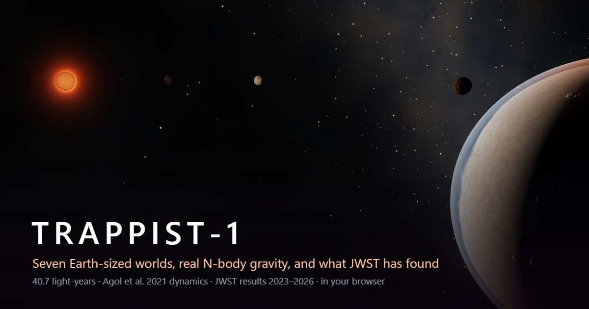

# TRAPPIST-1

An interactive 3D model of the TRAPPIST-1 system in the browser. Seven
Earth-sized planets move under direct N-body gravity, seeded from their
measured masses and orbits. Each one is drawn the way JWST's results allow,
with the transits, flares and resonances that make them so hard to read.



Built on the same foundation as the 3D Solar System project: three.js r160
vendored under `vendor/`, no build step, and every surface generated on the GPU
with no image textures. [PLAN.md](PLAN.md) has the science summary and the
phase-by-phase build log.

## Running it

ES modules need a server:

```bash
python tools/serve.py 8124
```

then open <http://localhost:8124>. On load the page integrates the system from
the 2015 reference epoch to today, which takes about two seconds.
`tools/serve.py` is a static server that disables caching. Plain
`python -m http.server` also works, but browsers may keep running a stale
module after you edit one.

Check the physics against the published numbers:

```bash
node tools/verify-transits.mjs 1500
```

## Controls

| Input | Action |
| --- | --- |
| drag / scroll / right-drag | orbit / zoom / pan |
| click a body or label, `1`–`7`, `0` | select and follow it (`0` is the star) |
| `space` | pause |
| `G` | guided tour (`←` / `→` to step) |
| `E` | view from Earth (scroll to zoom) |
| `J` | observatory: light curve, transit timing, resonances, timeline |
| `U` | stand on the selected planet (drag to look, scroll to zoom) |
| `R` | resonance view: conjunction spokes |
| `I` | thermal 15 µm view |
| `M` | transit sounds |
| `O` / `T` / `L` / `Z` | orbits / trails / labels / habitable zone |
| `H` | hide the interface |
| `Esc` | deselect, free the camera, or step off a planet |

## The physics

**Initial conditions** come from the transit-timing solution of Agol et al.
2021 (PSJ 2, 1): osculating *Jacobi* elements — period, a transit time,
e cos ω, e sin ω and mass ratio — at BJD 2457257.93 (27 Aug 2015). Jacobi
coordinates put each planet on an orbit about the barycentre of everything
inside it, so the conversion to Cartesian walks outward through the chain.
Units are AU, days and solar masses, with G = k².

**Integrator**: fourth-order Yoshida composition of leapfrog — symplectic, three
force evaluations per step — at Δt = 0.004 d, about 380 steps per orbit of b.
Energy drift stays around 10⁻¹⁰. Arriving at today means integrating ~4,100
days forward, which is done honestly at load rather than with a Keplerian
shortcut: the planets' mutual tugs over those years are part of the state.

**Frames**: the elements are in the sky frame. The system is rotated so the orbits
lie flat and Earth sits exactly along one axis, which keeps the real 0.1–0.3°
spread in inclination. That puts every transit, eclipse and the Earth view
into the same geometry.

**A convention that had to be found.** The paper gives e cos ω and e sin ω but
not which way the observer faces. With the textbook choice (observer on +Z),
the outer planets' timing variations came out around six hours and d missed an
observed transit by four hours. With the observer on −Z (ω + 180°), everything
lands:

| Check | Published | Simulated |
| --- | --- | --- |
| b transit forecasts, epochs 1–2 (Agol Table 15) | 7259.061221, 7260.572662 | within 0.01 min |
| b / c / d observed transits (Table 14) | σ 1.0 / 2.0 / 3.3 min | off by 3.7 / 0.2 / 6.5 min |
| Transit durations b…h (Table 5) | 36.06 … 76.16 min | all within 0.5 min |
| TTV half-amplitudes b…h | tens of minutes | 3.5, 5.3, 31, 31, 54, 37, 46 min |
| Laplace angles at epoch | librating | φ_bcd 177°, φ_cde 47°, φ_fgh 178°, all bounded |

## The star

TRAPPIST-1 is an M8 dwarf: 2,566 K, 12 % of the Sun's radius, 0.055 % of its
light.

- **Colour from physics.** The photosphere shader builds a temperature map and
  converts it with Planck's law at red, green and blue wavelengths, relative to
  2,566 K, so nothing is hand-coloured. A 500 K-cooler spot umbra drops to 11 %
  brightness in red, a 110 K facula rises to 1.46×, and a 9,000 K flare kernel
  is hundreds of times brighter in blue than its surroundings.
- **Spots** are discrete objects (`src/activity.js`): up to 48 at once, each
  born, growing and decaying over 12–72 days. Coverage is therefore a measured
  quantity. The 2 % default gives 1–2 % rotational modulation toward Earth in
  the K2 band, against ~1 % observed.
- **Flares** arrive as a Poisson process drawn from the K2 flare-frequency
  distribution (Vida et al. 2017: 0.53/day above 1.26 × 10³⁰ erg, cumulative
  slope 0.59). An 80-day test run gave 49 flares above that energy, against 42
  observed, with a largest of 2 × 10³³ erg, against 1.2 × 10³³ observed.
- **Flare light reaches only the planets that face it.** Each flare is treated as
  a 9,000 K patch on the surface radiating mostly straight out (Lambertian), so
  a planet facing it squarely gets up to 4× the average boost and planets on
  the far side get none. A 10³¹ erg flare adds ~15 % blue light; a 3 × 10³³ erg
  superflare adds ~15× blue on a planet facing it.

## The planets

Each planet has 2–4 **scenarios** (`src/scenarios.js`), graded against JWST:
*matches JWST*, *consistent*, *hypothesis*, *disfavoured* or *ruled out*. A
scenario sets the surface, any atmosphere, a Bond albedo and how efficiently
heat is carried around the planet. The surface shader works in each planet's
locked frame:
- an eyeball ocean opens under the star;
- volatiles freeze out on the night side;
- a cloud deck piles up over the substellar point.

The **thermal model** (`src/thermal.js`) gives each point's temperature from
its angle to the star:
T⁴(θ) = (1 − A)·T₀⁴·[(1 − ε)·max(cos θ, 0) + ε/4],
where A is the Bond albedo and ε how much heat is carried round. It then
integrates the 15 µm brightness JWST would see at eclipse. Each card shows
that prediction next to the measurement:

| Scenario | Model | JWST (2026 / 2023) | Night < 73 K |
| --- | --- | --- | --- |
| b, bare dark rock (A 0.1) | 489 K | 490 ± 17 / 503 ± 27 → −0.1σ / −0.5σ | passes |
| b, thick CO₂ (ruled out) | 404 K | −5.1σ / −3.7σ | fails, 356 K |
| c, bare rock (A 0.3) | 393 K | 369 ± 23 / 380 ± 31 → +1.1σ / +0.4σ | passes |
| c, thin CO₂ (ε 0.002) | 400 K | +1.3σ / +0.6σ | passes |
| c, Venus-like (ruled out) | 240 K | −5.6σ / −4.5σ | fails, 240 K |

Building this turned up a real constraint. A "thin" CO₂ atmosphere on c that
carried even 25 % of the heat around would warm the night side to 231 K, far
above the 2026 phase-curve limit of 73 K. Any atmosphere that survives must
move well under 1 % of the heat.

Press `I` for the thermal view: the same temperature field on a fixed
0–600 K scale.

## Observing

- **View from Earth** (`E`): a camera far along our real line of sight, with
  planets at true size. The orbits are edge-on at their real impact
  parameters, and every planet crosses the spotted disc.
- **Light curve**: sampled at every integrator step (5.8 simulated minutes), so
  even b's 36-minute transit is resolved at any speed. Transits use true radii,
  exact partial overlap at ingress and egress, and limb darkening. Spots follow
  the star's rotation. Flares use their *physical* durations, not the stretched
  on-screen ones. Visible and near-infrared bands are available. The visible
  band shows the problem the papers describe: spots and flares move the
  brightness as much as the planets do.
- **Transit timing**: observed-minus-predicted transit times for 2015 → now,
  recorded during the boot integration. The planets pull each other early and
  late on a ~490-day cycle; this is how their masses were measured.
- **Observations and timeline**: what each planet's card lists, from the 2016
  discovery to the 2026 JWST results. Papers are linked only where the DOI or
  arXiv ID was checked.

## The resonant chain

Neighbouring periods sit near 8:5, 5:3, 3:2, 3:2, 4:3, 3:2. Every set of three
is tied by a Laplace relation, and the five three-body angles stay in narrow
bands (the Resonances tab samples them daily since 2015).

The resonance view (`R`) marks every conjunction of neighbouring planets. The
two-body angles circulate: b–c conjunctions advance 237°, not exactly 240°, so
fixed spokes smear all the way round. Measuring the drift for every pair:

| Pair | Near | Drift period | Scatter about the drift |
| --- | --- | --- | --- |
| b–c | 8:5 | 501 d | 1.0° |
| c–d | 5:3 | 491 d | 2.3° |
| d–e | 3:2 | 494 d | 1.8° |
| e–f | 3:2 | 491 d | 1.7° |
| f–g | 4:3 | 484 d | 1.8° |
| g–h | 3:2 | 487 d | 0.7° |

All six drift together, once per ~491 days: Agol's TTV super-period
(491 ± 5 d), showing up as geometry. With the spokes turning at that rate,
every pair's conjunctions stack onto exactly p − q spokes: three for b–c, two
for c–d, one for each of the rest.

## Being there

- **Stand on a planet** (`U`): a few km above the true-size globe, placed by
  angle from the substellar point. From e the star is 2.2° across (4× the Sun
  from Earth) and never moves. Neighbours pass as discs up to the size of our
  Moon. Scenarios with air get a sky that drowns the stars by day and turns
  orange at the terminator.
- **The Sun** appears from there as a V ≈ 5.3 star along our line of sight, in
  Leo — the opposite side of the sky from where TRAPPIST-1 sits in ours
  (Aquarius).
- **Guided tour** (`G`): ten stops, each from a clean state.
- **Transit sounds** (`M`): each transit rings a note at 880 Hz × P_b / P, so
  neighbours sound near a minor sixth, a major sixth, fifths and a fourth.

## Layout

```
index.html, styles.css
src/
  main.js          renderer, bloom, loop, input, Earth/surface/resonance modes
  constants.js     units, G, epoch, scale and integrator settings
  data.js          star and planets: Agol 2021 tables, JWST summaries, activity
  scenarios.js     23 JWST-graded scenarios and the 15 µm measurements
  observations.js  per-planet observation lists and the discovery timeline
  orbital.js       Kepler solver, elements ↔ state vectors
  physics.js       N-body system, Yoshida-4 integrator
  system.js        Jacobi initial conditions, sky → system frame, boot integration
  transits.js      transit detection and ephemeris fitting
  resonance.js     period ratios, Laplace angles, conjunctions, pattern speed
  habitable.js     Kopparapu habitable zone, equilibrium temperatures
  thermal.js       locked-planet temperature field, 15 µm brightness
  activity.js      spots, flares, flare light toward any direction
  observe.js       photometer: transits, spots and flares toward Earth
  plots.js         light curve, TTV and Laplace plots
  observatory.js   the observatory drawer
  surface.js       standing on a planet
  tour.js          guided tour
  sound.js         transit chimes
  cover.js         renders the share card (/?cover)
  scene.js         scene graph and per-frame sync
  controls.js      orbit / dolly / pan camera
  ui.js            panel, picker, info card
  shaders/
    star.js        M-dwarf photosphere: Planck colour, spots, faculae, flares
    world.js       locked planet surfaces, thermal view, shadows, atmospheres
    fx.js          glow, habitable zone, trails, sky dome, spokes, Sun marker
    stars.js, noise.js
tools/
  verify-transits.mjs  physics check against Agol et al. 2021
  serve.py             no-cache dev server (also saves the share card)
og/cover.png           1200 × 630 share card, rendered from the app
vendor/                three.js r160 + bloom post-processing
```

## Known approximations

- **Node longitudes** are set to Ω = 0 for every planet. Transits do not
  constrain them, and the orbits are coplanar to under 0.3°.
- **Drift since 2015:** integrating forward from the 2015 fit carries its
  uncertainty, so predicted transit times drift by minutes to tens of minutes
  per decade.
- **Drawn sizes:** planets are drawn 4× life size by default. True scale is one
  click, and the Earth and surface views switch to it automatically.
  Planet-on-planet shadows use the drawn radii.
- **Representative, not fitted:**
  - spot and facula temperature contrasts;
  - limb-darkening coefficients;
  - scenario albedos and heat redistribution;
  - surface textures, which are procedural illustrations of each scenario.
- **On-screen flares:** kernels are drawn far larger than real, with surface
  brightness scaled down to keep the total light right. On screen they are
  stretched to last at least 2.5 s; the light curve uses real durations.
- **Light curve:** planets overlapping during a simultaneous transit are not
  subtracted, and spots crossed by a transiting planet are not modelled.
- **Star's spin axis** is taken along the orbit normal (Rossiter–McLaughlin
  measurements are consistent with alignment).
- **Missing physics:** no general relativity or tides in the integrator. Both
  are negligible on these timescales: b's relativistic precession is ~1° per
  century.

## Sources

- NASA / STScI, *What is Webb revealing about the TRAPPIST-1 system?* (Jan 2026)
- Agol et al. 2021, PSJ 2, 1 — [doi:10.3847/PSJ/abd022](https://doi.org/10.3847/PSJ/abd022)
- Greene et al. 2023, Nature — [doi:10.1038/s41586-023-05951-7](https://doi.org/10.1038/s41586-023-05951-7)
- Zieba et al. 2023, Nature — [doi:10.1038/s41586-023-06232-z](https://doi.org/10.1038/s41586-023-06232-z)
- Ducrot et al. 2024, Nature Astronomy (b at 12.8 and 15 µm)
- Gillon et al. 2026, Nature Astronomy — [doi:10.1038/s41550-026-02806-9](https://doi.org/10.1038/s41550-026-02806-9)
- Piaulet-Ghorayeb et al. 2025, ApJ — [doi:10.3847/1538-4357/adf207](https://doi.org/10.3847/1538-4357/adf207)
- Espinoza et al. 2025, ApJL — [doi:10.3847/2041-8213/adf42e](https://doi.org/10.3847/2041-8213/adf42e)
- Glidden et al. 2025, ApJL — [doi:10.3847/2041-8213/adf62e](https://doi.org/10.3847/2041-8213/adf62e)
- Lim et al. 2026, AJ (accepted) — [arXiv:2608.17207](https://arxiv.org/abs/2608.17207)
- Vida et al. 2017; Luger et al. 2017; de Wit et al. 2018; Kopparapu et al. 2013/2014
